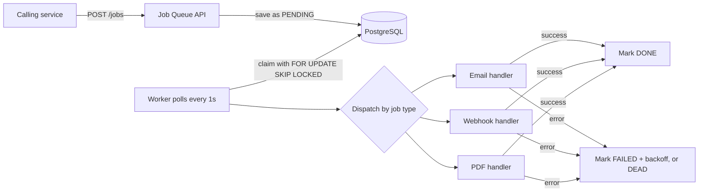
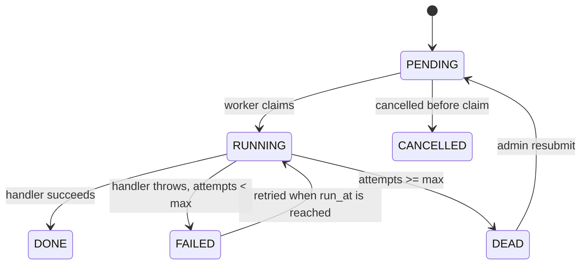

# Job Queue Service

A standalone **asynchronous job queue microservice** built with **Java 21**, **Spring Boot 3** and **PostgreSQL**.

Other services submit background jobs (send an email, call a webhook, generate a PDF) over a simple REST API or a tiny Java SDK. The service stores each job in PostgreSQL, runs it in the background, retries failures with **exponential backoff**, and makes sure **two workers never claim the same job** by using `FOR UPDATE SKIP LOCKED`.

---

## Table of Contents

- [The problem it solves](#the-problem-it-solves)
- [How it works](#how-it-works)
- [Job lifecycle](#job-lifecycle)
- [Tech stack](#tech-stack)
- [Job types](#job-types)
- [Design decisions](#design-decisions)
- [Delivery guarantees](#delivery-guarantees)
- [API reference](#api-reference)
- [Getting started](#getting-started)
- [Testing](#testing)
- [SDK usage](#sdk-usage)
- [Project structure](#project-structure)
- [Known limitations and roadmap](#known-limitations-and-roadmap)

---

## The problem it solves

When an API request triggers slow or unreliable work (sending an email, calling another server, building a report), doing that work inside the request has three problems:

1. **The user waits** for slow work to finish.
2. **Failures are lost.** If the work fails, nobody retries it.
3. **Running many workers is risky.** Without coordination, two workers can pick the same job and run it twice.

This service moves that work into a queue. The caller gets an immediate `202 Accepted`, and the service handles execution, retries, and failure tracking.

---

## How it works



1. A client sends `POST /jobs` with a `type` and a `payload`. The job is saved with status `PENDING` and the API returns `202 Accepted` with a job id.
2. A scheduled worker (`@Scheduled(fixedDelay = 1000)`) runs about every second.
3. The worker claims the oldest runnable job using `SELECT ... FOR UPDATE SKIP LOCKED` and sets it to `RUNNING` in one short transaction.
4. The job is dispatched to a handler based on its `type`.
5. On success the job becomes `DONE`.
6. On failure the attempt counter increases and the job is rescheduled with exponential backoff. After 5 failed attempts the job becomes `DEAD`.

---

## Job lifecycle



Every job starts with `max_attempts = 5`. A job gets **5 attempts in total**. Retry delay is `2^attempts` seconds:

| Failure number | Delay before next attempt | Result |
|----------------|---------------------------|--------|
| 1 | 2 s | `FAILED` |
| 2 | 4 s | `FAILED` |
| 3 | 8 s | `FAILED` |
| 4 | 16 s | `FAILED` |
| 5 | none | `DEAD` |

`DEAD` jobs are kept (not deleted). The last error message is stored in `last_error`, and an admin can requeue the job after fixing the cause.

---

## Tech stack

| Layer | Technology |
|-------|------------|
| Language | Java 21 |
| Framework | Spring Boot 3.5 (Web, Data JPA, Actuator) |
| Database | PostgreSQL 15 (JSONB payloads) |
| Migrations | Flyway |
| Observability | Spring Actuator, Micrometer, Prometheus endpoint |
| Containers | Docker Compose (PostgreSQL) |
| Testing | JUnit 5, Testcontainers |
| Build | Maven (wrapper included) |
| Utilities | Lombok |

---

## Job types

| Type | Payload fields | Current behaviour |
|------|----------------|-------------------|
| `SEND_EMAIL` | `to`, `subject`, `body` | Logs the payload (stub). Ready to be connected to a mail sender. |
| `SEND_WEBHOOK` | `url`, `body` | Sends an HTTP `POST` with the JSON `body` to `url`. Any HTTP error fails the job and triggers a retry. |
| `GENERATE_PDF` | `title`, `content` | Writes a text report to `/tmp` (placeholder for real PDF generation). |

An unknown `type` is rejected by the API with `400 Bad Request`.

### Adding a new job type

1. Create a class that implements `JobHandler` and annotate it with `@Component`.
2. Inject it into `JobWorker` and add a `case` for the new type in `dispatch(...)`.
3. Add the new type name to the allowed list in `JobController`.

---

## Design decisions

**`FOR UPDATE SKIP LOCKED` for safe concurrent workers**
The claim query locks the row it selects. Other workers skip locked rows instead of waiting, so each worker gets a different job. No distributed lock or extra coordination service is needed, and it works across multiple service instances.

**Short transactions**
The row lock is held only while the job is claimed and marked `RUNNING`. The handler runs after the transaction commits, so a slow handler never holds a database lock.

**Exponential backoff**
A failing job is not retried immediately. `run_at` is set to `now + 2^attempts` seconds, which protects a struggling downstream system from a retry storm.

**`DEAD` status instead of deleting**
Exhausted jobs stay in the table with their `last_error`, so failures can be inspected and requeued.

**Partial index**
`idx_jobs_status_run_at` covers only `PENDING` and `FAILED` rows. Completed jobs are not indexed, so the index stays small as history grows.

**Handler per job type**
Each job type has its own `JobHandler` implementation. The worker only claims, dispatches and records the result, and holds no business logic.

**Flyway migrations**
The schema is versioned in `db/migration`. Hibernate auto-DDL is turned off (`ddl-auto: none`).

---

## Delivery guarantees

- **No double claim.** A job is claimed by one worker at a time. This is what `SKIP LOCKED` guarantees.
- **At-least-once execution.** If the service crashes after a handler finishes but before the job is marked `DONE`, the job may run again. Write handlers to be **idempotent** (safe to run twice).

---

## API reference

### Submit a job

```http
POST /jobs
Content-Type: application/json

{
  "type": "SEND_EMAIL",
  "payload": { "to": "user@example.com", "subject": "Hello", "body": "Welcome!" }
}
```

Response `202 Accepted`:

```json
{ "jobId": "3f2b8c1e-...", "status": "PENDING", "createdAt": "2026-10-14T09:30:00" }
```

Errors: `400` if `type` is missing or unknown.

### Get job status

```http
GET /jobs/{id}
```

Response `200 OK`:

```json
{
  "jobId": "3f2b8c1e-...",
  "type": "SEND_EMAIL",
  "status": "DONE",
  "attempts": 0,
  "createdAt": "...",
  "updatedAt": "...",
  "completedAt": "...",
  "lastError": "N/A"
}
```

Returns `404` if the job does not exist.

### Admin endpoints

| Method | Endpoint | Description |
|--------|----------|-------------|
| `GET` | `/admin/jobs?status=FAILED&type=SEND_EMAIL&limit=20` | List jobs. `status` and `type` are optional filters. `limit` defaults to 20. |
| `POST` | `/admin/jobs/{id}/resubmit` | Put a job back to `PENDING` with attempts reset to 0. Intended for `DEAD` jobs. |
| `DELETE` | `/admin/jobs/{id}` | Cancel a job. Only `PENDING` jobs change to `CANCELLED`. Other jobs are returned unchanged. |

> The admin endpoints are not authenticated yet. Do not expose this service publicly without adding security (see [roadmap](#known-limitations-and-roadmap)).

### Monitoring

| Endpoint | Description |
|----------|-------------|
| `GET /actuator/health` | Service and database health |
| `GET /actuator/prometheus` | Metrics in Prometheus format |

---

## Getting started

### Prerequisites

- Java 21
- Docker and Docker Compose
- Maven (or use the included `./mvnw`)

### Run

```bash
git clone https://github.com/<your-username>/Job-Queue-Service.git
cd Job-Queue-Service

# 1. Start PostgreSQL
docker compose up -d

# 2. Start the service
./mvnw spring-boot:run
```

Flyway creates the `jobs` table automatically on the first start.

| Service | Port |
|---------|------|
| Job Queue API | 8083 |
| PostgreSQL | 5436 |

### Verify

```bash
curl http://localhost:8083/actuator/health
```

Expected: `{"status":"UP", ...}`

### Try it

```bash
# Submit a job
curl -X POST http://localhost:8083/jobs \
  -H "Content-Type: application/json" \
  -d '{"type":"SEND_EMAIL","payload":{"to":"user@example.com","subject":"Hi","body":"Test"}}'

# Check its status (use the jobId from the response)
curl http://localhost:8083/jobs/<jobId>

# List failed jobs
curl "http://localhost:8083/admin/jobs?status=FAILED&limit=10"
```

### Configuration

Settings are in `src/main/resources/application.yaml`:

| Setting | Default |
|---------|---------|
| `spring.datasource.url` | `jdbc:postgresql://localhost:5436/jobqueue` |
| `spring.datasource.username` / `password` | `jobqueue` / `jobqueue` |
| `server.port` | `8083` |

---

## Testing

Docker must be running because the tests start a real PostgreSQL container.

```bash
./mvnw test
```

### Concurrency test

`JobWorkerConcurrencyTest` starts PostgreSQL with Testcontainers, inserts 10 jobs, and runs 3 threads that all call the worker at the same time. It asserts that all 10 jobs reach `DONE` and none remain `PENDING`.

```bash
./mvnw test -Dtest=JobWorkerConcurrencyTest
```

It uses a real database (not a mock), so it exercises the actual `SKIP LOCKED` behaviour.

---

## SDK usage

The `sdk` package contains `JobQueueClient`, a small client other Java services can use to submit jobs.

```java
// Register the client
@Bean
public JobQueueClient jobQueueClient() {
    return new JobQueueClient("http://localhost:8083");
}

// Submit a job
jobQueueClient.submit("SEND_EMAIL", Map.of(
    "to", "user@example.com",
    "subject", "Transfer Completed",
    "body", "Your transfer was successful."
));
```

To use it from another project, add this service as a Maven dependency (after installing it locally with `./mvnw install`):

```xml
<dependency>
    <groupId>com.Job_Queue</groupId>
    <artifactId>JQ_Service</artifactId>
    <version>0.0.1-SNAPSHOT</version>
</dependency>
```

---

## Project structure

```text
src/main/java/com/Job_Queue/JQ_Service/
├── api/        JobController, AdminController, TestController
├── core/       JobService, JobWorker, JobRepository
├── handlers/   JobHandler, EmailHandler, WebhookHandler, PdfHandler
├── model/      Job (JPA entity)
├── sdk/        JobQueueClient
└── JqServiceApplication.java

src/main/resources/
├── application.yaml
└── db/migration/V1__create_jobs_table.sql

src/test/java/.../JobWorkerConcurrencyTest.java
docker-compose.yml
```

---

## Known limitations and roadmap

| Area | Current state | Planned improvement |
|------|---------------|---------------------|
| Crash recovery | A job left in `RUNNING` after a crash stays `RUNNING` | Add `locked_at` with a visibility timeout and a task that requeues stale jobs |
| Throughput | One worker thread per instance, one job per poll | Claim jobs in batches and process with a thread pool; use `LISTEN/NOTIFY` instead of polling |
| Test strength | Test checks final `DONE` count | Also count handler executions per job to prove each job ran once |
| Retry | Fixed exponential delay | Add jitter |
| Idempotency | Handlers must handle repeats themselves | Add an idempotency key per job |
| Handlers | Email and PDF are placeholders | Real mail sending and PDF generation |
| Job status | Stored as a string | Use a Java enum |
| Security | Admin endpoints are open | Add authentication and roles |
| Extensibility | New types need a `switch` case | Inject `Map<String, JobHandler>` so no switch is needed |
